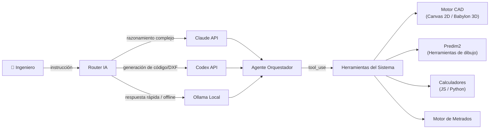
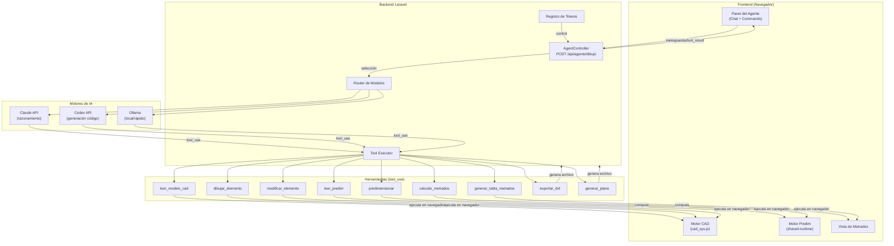
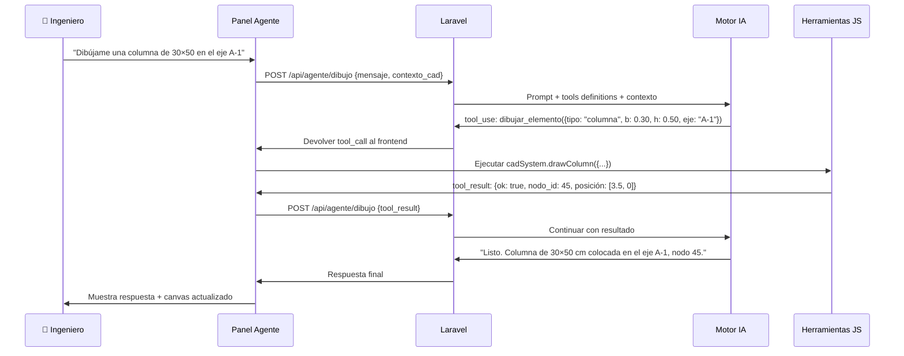
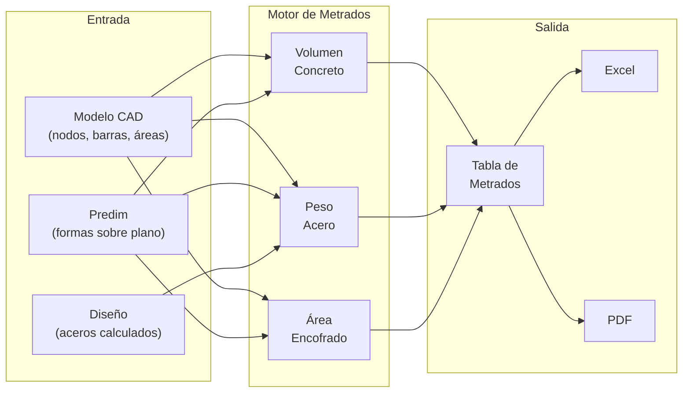
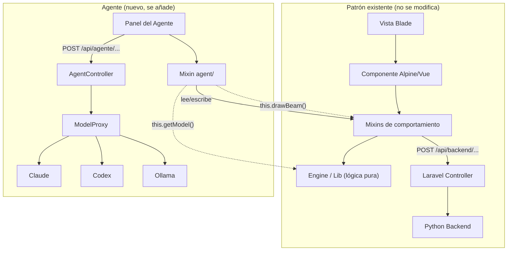
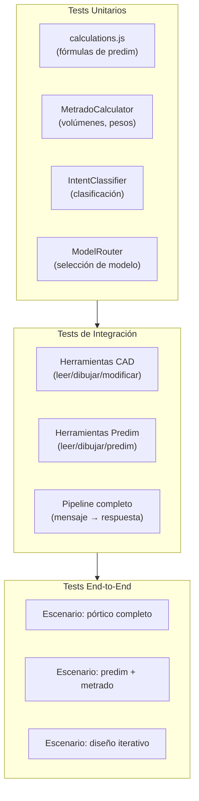
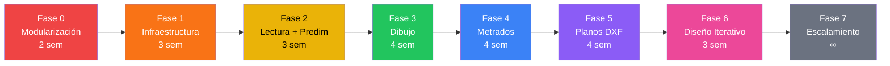

# Plan Maestro: Agente IA de Dibujo y Metrados

> **Proyecto:** Rizabal & Asociados — ryaie.com  
> **Fecha:** 2 de noviembre de 2026  
> **Módulos objetivo:** Análisis Estructural (`/software/etabs`) y Predim2 (`/software/predim2`)  
> **Stack IA:** Claude (Anthropic) · Codex (OpenAI) · Ollama (local/offline)

---

## 1. Visión General

### 1.1 Qué es

Un agente de IA integrado al sistema web-etabs que **asiste al ingeniero estructural** en dos tareas repetitivas y de alto consumo de tiempo:

1. **Dibujo asistido** — Generar, modificar y optimizar planos estructurales (secciones, mallas de refuerzo, detalles) a partir de instrucciones en lenguaje natural o de los resultados de un cálculo.
2. **Metrados automáticos** — Cuantificar materiales (concreto, acero, encofrado) directamente desde el modelo CAD o desde las hojas de predimensionamiento, generando tablas de metrados listas para presupuestar.

### 1.2 Principio rector

> **El agente no calcula ni inventa datos.** Opera las herramientas que ya existen: lee el modelo CAD, ejecuta los calculadores existentes, dibuja con el motor Canvas/Babylon.js/DXF actual, y genera metrados a partir de las geometrías y aceros ya definidos. Todo número proviene de un calculador del sistema.

### 1.3 Por qué tres motores de IA

| Motor | Rol | Cuándo |
|-------|-----|--------|
| **Claude** (Anthropic) | Razonamiento complejo: interpretar instrucciones ambiguas, optimizar diseño iterativo, explicar resultados citando norma E.060/E.030 | Online, tareas que requieren alto razonamiento |
| **Codex** (OpenAI) | Generación de código/DXF: producir snippets de dibujo, generar bloques paramétricos, transformar geometría | Online, tareas de generación de código y geometría |
| **Ollama** (local) | Respuesta rápida offline: sugerir predimensionamiento, clasificar tipos de elementos, autocompletar datos de entrada, draft de metrados | Siempre disponible, sin latencia de red, sin costo |



---

## 2. Análisis del Estado Actual

### 2.1 Análisis Estructural (`/software/etabs`)

**Ruta:** `/software/analisis-estructural-de-armaduras` y `/software/etabs`  
**Vista:** `matlab.admAnalisisEstructuralDeArmaduras`  
**Motor JS:** `resources/js/cad/cad_sys.js` — componente Alpine.js con mixins

```
resources/js/cad/
├── cad_sys.js              ← Orquestador Alpine (estado reactivo + spread de mixins)
├── model/                  ← Dominio: Node, Beam, Area, sections, parametricModels
├── canvas2d/               ← Motor 2D: renderer, grid, grid_editor, states
├── 3d/                     ← Motor 3D: Babylon.js (viewer3d, camera, axes)
├── diagrams/               ← Diagramas de fuerzas P/V/M
├── lib/                    ← Utilidades puras (geometría, unidades)
├── engine/                 ← Contratos sísmicos, payload builders, mocks
└── mixins/
    ├── core/               ← options, events, actions, core-ui
    ├── select/             ← selection, viewport, view-filter
    ├── edit/               ← geometry, clipboard, delete, undo-redo, factory, queries
    ├── grids/              ← reference-grid, story-grid, story-editor, elevation
    ├── dialogs/            ← assign-dialogs, display-dialogs
    ├── analysis/           ← analysis, animation, report, design, seismic/
    └── io/                 ← autosave, file-io/ (model-file, e2k, print, json-io)
```

**Backend Python:** `python-backend/seismic/` (OpenSeesPy) — análisis modal-espectral  
**Backend diseño:** `python-backend/design/` — diseño de columnas, muros (interacción, corte, esbeltez)  
**Persistencia:** `CadModel` en BD (autosave + "Mis modelos")

> [!NOTE]
> El sistema CAD ya tiene un patrón claro de extensibilidad: **mixin de comportamiento** + **modal Blade** + **lógica pura en engine/**. El agente se integrará como un nuevo mixin sin alterar los existentes.

### 2.2 Predim2 (`/software/predim2`)

**Ruta:** `/software/predim2`  
**Vista:** `etabs.index` — Vue 3 + Element Plus + `@mlightcad/cad-viewer`  
**Motor JS:** `resources/js/etabs/` (App.vue + componentes Vue)

**Predim original:** `resources/js/predim/` — sistema Canvas 2D con herramientas de dibujo

```
resources/js/predim/
├── index.js                ← Entry point
├── ribbon-adapter.js       ← Adaptador de ribbon/toolbar
├── app/shared-runtime.js   ← Runtime principal (~3800 líneas)
│   ├── Renderizado PDF     ← Carga planos PDF sobre el canvas
│   ├── Herramientas        ← Rectangle, Cuadrado, Circulo, Te, Ele, Vigas, Zapatas, Losas, Placas
│   ├── Escalado            ← Conversión pixel↔metros con escala configurable
│   └── Reportes            ← Tablas HTML por tipo de elemento
├── tools/
│   ├── base/Tool.js        ← Clase base de herramientas
│   └── columns/            ← CuadradoTool, RectangleTool (refactorizados)
└── utils/calculations.js   ← Funciones puras de predimensionamiento
```

**Funcionalidades actuales de Predim:**

| Herramienta | Elementos | Cálculos |
|-------------|-----------|----------|
| Columna rectangular | Área tributaria → Ar = P / (0.45·f'c) → b × lado | Predim E.060 |
| Columna cuadrada | AT → Ac → lado = √Ac | Predim E.060 |
| Columna circular | AT → Ac → radio = √(Ac/π) | Predim E.060 |
| Columna T / L | AT → Ac → lado ajustado | Predim E.060 |
| Vigas principales | Luz libre → h = L/14 | Criterio práctico |
| Vigas secundarias | Luz libre → h = L/18.5 | Criterio práctico |
| Vigas de cimentación | Según cargas | Predim |
| Zapatas | AT × npisos / q_adm | Predim suelo |
| Losas aligeradas | h = L/25 (1 dir.) | Predim E.060 |
| Losas macizas | h = L/40 (2 dir.) | Predim E.060 |
| Placas | Z·U·S / (R·0.15·f'c) | Predim sísmica |

> [!IMPORTANT]
> `shared-runtime.js` tiene ~3800 líneas en un solo archivo. La fase 1 del agente requiere primero **modularizar** este archivo para poder exponer herramientas al agente. Los cálculos ya están parcialmente extraídos en `utils/calculations.js`.

### 2.3 Sistema de generación de planos (referencia)

Existe un documento de especificación para la API Node CAD de planos (`docs/api-node-cad-plano.md`) con:
- Contrato API semántico (JSON → DXF)
- Principios de separación dominio/dibujo/render
- Estándar de capas DXF
- Escala automática y texto en mm de papel

Este patrón es la **referencia arquitectónica** para la capa de dibujo del agente.

---

## 3. Arquitectura del Agente

### 3.1 Diagrama de componentes



### 3.2 Flujo de una interacción típica



### 3.3 Router de modelos IA

```javascript
// agents/router/model-router.js
export class ModelRouter {
  constructor(config) {
    this.models = {
      claude: { endpoint: '/api/agente/claude', capabilities: ['reasoning', 'design-iteration', 'code-review'] },
      codex:  { endpoint: '/api/agente/codex',  capabilities: ['code-gen', 'dxf-gen', 'geometry-transform'] },
      ollama: { endpoint: '/api/agente/ollama',  capabilities: ['quick-suggest', 'autocomplete', 'classify', 'draft'] }
    };
  }

  route(intent) {
    // Offline → siempre Ollama
    if (!navigator.onLine) return 'ollama';
    // Tareas complejas → Claude
    if (['optimize-design', 'explain-results', 'iterate-section'].includes(intent)) return 'claude';
    // Generación de código/DXF → Codex
    if (['generate-dxf', 'parametric-block', 'batch-geometry'].includes(intent)) return 'codex';
    // Todo lo demás → Ollama (rápido, sin costo)
    return 'ollama';
  }
}
```

---

## 4. Estructura de Carpetas

```
agents/
├── README.md                           ← Este documento
├── config/
│   ├── tools.json                      ← Definiciones de herramientas (tool_use schemas)
│   ├── prompts/
│   │   ├── system-dibujo.md            ← Prompt de sistema para el agente de dibujo
│   │   ├── system-metrados.md          ← Prompt de sistema para el agente de metrados
│   │   ├── system-predim.md            ← Prompt de sistema para predim
│   │   └── fragments/
│   │       ├── norma-e060.md           ← Fragmentos cacheables de norma
│   │       ├── norma-e030.md
│   │       └── convenciones-dibujo.md  ← Convenciones de capas, texto, escalas
│   └── models.json                     ← Configuración de modelos (Claude/Codex/Ollama)
│
├── router/
│   ├── model-router.js                 ← Selector de modelo según intención
│   └── intent-classifier.js            ← Clasificador de intención del usuario
│
├── tools/
│   ├── cad/                            ← Herramientas para Análisis Estructural
│   │   ├── leer-modelo.js              ← Lee nodos, barras, áreas, secciones
│   │   ├── dibujar-elemento.js         ← Crea nodos/barras/áreas en el canvas
│   │   ├── modificar-elemento.js       ← Edita propiedades de elementos existentes
│   │   ├── asignar-seccion.js          ← Asigna secciones y materiales
│   │   ├── consultar-resultados.js     ← Lee resultados del análisis sísmico
│   │   └── exportar-modelo.js          ← Exporta a JSON/E2K
│   │
│   ├── predim/                         ← Herramientas para Predim2
│   │   ├── leer-plano.js              ← Lee el plano PDF cargado y las formas
│   │   ├── predimensionar.js          ← Ejecuta predim por tipo de elemento
│   │   ├── dibujar-forma.js           ← Dibuja formas (columnas, vigas, losas)
│   │   ├── modificar-forma.js         ← Mueve, redimensiona, elimina formas
│   │   ├── leer-reporte.js            ← Lee las tablas de reporte actuales
│   │   └── escalar-plano.js           ← Ajusta la escala del plano
│   │
│   ├── metrados/                       ← Herramientas de metrados
│   │   ├── calcular-concreto.js        ← Volumen de concreto por elemento
│   │   ├── calcular-acero.js           ← Peso de acero por diámetro
│   │   ├── calcular-encofrado.js       ← Área de encofrado
│   │   ├── generar-tabla.js            ← Tabla de metrados formateada
│   │   ├── exportar-excel.js           ← Exportar a Excel/CSV
│   │   └── comparar-versiones.js       ← Comparar metrados entre versiones
│   │
│   └── planos/                         ← Herramientas de generación de planos
│       ├── generar-seccion.js          ← Sección típica con dimensiones
│       ├── generar-refuerzo.js         ← Sección con refuerzo
│       ├── generar-malla.js            ← Mallas de acero
│       ├── exportar-dxf.js             ← Generar archivo DXF
│       └── cuadro-acero.js             ← Cuadro resumen de acero
│
├── ui/
│   ├── components/
│   │   ├── AgentPanel.vue              ← Panel principal del chat (Vue 3)
│   │   ├── AgentToolbar.vue            ← Barra de herramientas del agente
│   │   ├── MetradosTable.vue           ← Tabla de metrados interactiva
│   │   ├── CommandPalette.vue          ← Paleta de comandos rápidos
│   │   └── AgentStatus.vue             ← Estado del agente (modelo activo, tokens)
│   └── agent-panel.blade.php           ← Integración Blade para el panel
│
├── backend/
│   ├── AgentController.php             ← Controlador Laravel principal
│   ├── AgentToolRegistry.php           ← Registro de herramientas disponibles
│   ├── ModelProxy.php                  ← Proxy a Claude/Codex/Ollama
│   ├── OllamaService.php              ← Cliente para Ollama local
│   ├── TokenTracker.php                ← Control de consumo por usuario
│   └── middleware/
│       └── AgentThrottle.php           ← Rate limiting para el agente
│
├── metrados/
│   ├── engine/
│   │   ├── MetradoCalculator.js        ← Motor principal de cálculo de metrados
│   │   ├── ConcreteVolume.js           ← Cálculo de volúmenes de concreto
│   │   ├── SteelWeight.js              ← Cálculo de peso de acero
│   │   ├── FormworkArea.js             ← Cálculo de áreas de encofrado
│   │   └── UnitPrices.js               ← Precios unitarios (configurable)
│   ├── templates/
│   │   ├── metrado-general.json        ← Plantilla de metrado general
│   │   ├── metrado-cimentacion.json    ← Plantilla de cimentación
│   │   └── metrado-superestructura.json← Plantilla de superestructura
│   └── export/
│       ├── excel-formatter.js          ← Formateador para Excel
│       └── pdf-formatter.js            ← Formateador para PDF
│
└── tests/
    ├── unit/
    │   ├── model-router.test.js
    │   ├── metrado-calculator.test.js
    │   ├── concrete-volume.test.js
    │   ├── steel-weight.test.js
    │   └── intent-classifier.test.js
    ├── integration/
    │   ├── agent-cad-tools.test.js
    │   ├── agent-predim-tools.test.js
    │   └── agent-metrados.test.js
    └── fixtures/
        ├── modelo-portico-3pisos.json
        ├── predim-vivienda-5pisos.json
        └── metrado-esperado.json
```

---

## 5. Conceptos Clave

### 5.1 Herramientas del Agente (Tool Use)

Cada herramienta es una función que el agente puede invocar. Se definen con JSON Schema estricto y se ejecutan **en el navegador** (no en el servidor). El servidor solo intermedia.

```json
{
  "name": "dibujar_elemento",
  "description": "Dibuja un elemento estructural en el modelo CAD. Crea nodos y barras/áreas según el tipo.",
  "strict": true,
  "parameters": {
    "type": "object",
    "properties": {
      "tipo": {
        "type": "string",
        "enum": ["columna", "viga", "placa", "losa", "zapata"],
        "description": "Tipo de elemento estructural"
      },
      "posicion": {
        "type": "object",
        "properties": {
          "x": { "type": "number", "description": "Coordenada X en metros" },
          "y": { "type": "number", "description": "Coordenada Y en metros" },
          "z": { "type": "number", "description": "Coordenada Z en metros (piso)" }
        },
        "required": ["x", "y"]
      },
      "seccion": {
        "type": "object",
        "properties": {
          "b": { "type": "number", "description": "Ancho en metros" },
          "h": { "type": "number", "description": "Peralte en metros" }
        }
      },
      "material": {
        "type": "object",
        "properties": {
          "fc": { "type": "number", "description": "f'c en kg/cm²", "default": 210 },
          "fy": { "type": "number", "description": "fy en kg/cm²", "default": 4200 }
        }
      }
    },
    "required": ["tipo", "posicion"],
    "additionalProperties": false
  }
}
```

### 5.2 Metrados Automáticos

El motor de metrados extrae cantidades directamente de las geometrías del modelo:



**Fórmulas base de metrado:**

| Elemento | Concreto (m³) | Acero (kg) | Encofrado (m²) |
|----------|---------------|------------|-----------------|
| Columna | b × h × H_piso | Σ(n_barras × L × peso_unitario) + estribos | 2(b+h) × H_piso |
| Viga | b × h × L_luz | Σ(As × L) + estribos | b_fondo × L + 2 × h × L |
| Losa aligerada | e × L × ancho × 0.57 | malla + bastones | L × ancho (fondo) |
| Losa maciza | e × L × ancho | malla 2 dirs | L × ancho (fondo) |
| Zapata | B × L × h_z | parr. inf + sup | perímetro × h |
| Placa | e × L × H | Σ(vertical + horizontal) | 2 × L × H |

### 5.3 Integración con el Sistema Existente

El agente se integra siguiendo el patrón existente del sistema:



---

## 6. Uso y Manejo

### 6.1 Para el Ingeniero (Usuario Final)

#### Comandos de Dibujo
```
"Dibuja un pórtico de 3 pisos, 4 vanos de 5m, altura 3m"
"Pon una columna de 30×60 en la intersección de A y 1"
"Cambia todas las vigas del primer piso a 25×50"
"Dibuja la malla de losa aligerada en el paño A1-B2"
"Hazme el predimensionamiento de este plano" (con PDF cargado)
```

#### Comandos de Metrados
```
"Dame el metrado de concreto de todas las columnas"
"¿Cuánto acero necesito para las vigas del piso 2?"
"Genera el metrado completo y expórtalo a Excel"
"Compara el metrado antes y después de cambiar las secciones"
"¿Cuál es el peso total de acero por m² de construcción?"
```

#### Comandos de Planos
```
"Genera la sección típica con el refuerzo"
"Dibuja las mallas de la zapata"
"Exporta el plano en DXF con formato A1"
"Ponle las cotas al detalle de la columna"
```

### 6.2 Para el Desarrollador

#### Agregar una herramienta nueva

1. Crear el archivo en `agents/tools/<dominio>/nueva-herramienta.js`
2. Definir el schema en `agents/config/tools.json`
3. Registrar en `AgentToolRegistry.php`
4. Agregar test en `agents/tests/`

```javascript
// agents/tools/cad/leer-modelo.js
export const leerModelo = {
  name: 'leer_modelo_cad',
  execute(params, cadSystem) {
    const model = {
      nodes: cadSystem.nodes.map(n => ({ id: n.id, x: n.x, y: n.y, z: n.z })),
      beams: cadSystem.beams.map(b => ({
        id: b.id,
        nodeI: b.nodeI.id,
        nodeJ: b.nodeJ.id,
        section: b.section?.label,
        type: b.type // 'viga', 'columna'
      })),
      areas: cadSystem.areas.map(a => ({
        id: a.id,
        nodes: a.nodes.map(n => n.id),
        thickness: a.thickness,
        type: a.type // 'losa', 'placa', 'zapata'
      }))
    };

    // Filtrar por lo que pidió el agente
    if (params.tipo) {
      model.beams = model.beams.filter(b => b.type === params.tipo);
      model.areas = model.areas.filter(a => a.type === params.tipo);
    }
    if (params.piso) {
      // Filtrar por nivel Z del piso
    }

    return model;
  }
};
```

#### Agregar un modelo IA nuevo

Editar `agents/config/models.json`:

```json
{
  "models": {
    "claude": {
      "provider": "anthropic",
      "model": "claude-opus-5-5",
      "api_key_env": "ANTHROPIC_API_KEY",
      "max_tokens": 4096,
      "thinking": { "type": "enabled", "budget_tokens": 8000 },
      "capabilities": ["reasoning", "design-iteration", "explain"],
      "cost_per_1k_input": 0.015,
      "cost_per_1k_output": 0.075
    },
    "codex": {
      "provider": "openai",
      "model": "codex-mini-latest",
      "api_key_env": "OPENAI_API_KEY",
      "max_tokens": 4096,
      "capabilities": ["code-gen", "dxf-gen", "geometry"],
      "cost_per_1k_input": 0.003,
      "cost_per_1k_output": 0.015
    },
    "ollama": {
      "provider": "ollama",
      "model": "qwen2.5-coder:14b",
      "endpoint": "http://127.0.0.1:11434",
      "max_tokens": 4096,
      "capabilities": ["quick-suggest", "autocomplete", "classify", "draft"],
      "cost_per_1k_input": 0,
      "cost_per_1k_output": 0
    }
  },
  "default_model": "ollama",
  "fallback_chain": ["claude", "codex", "ollama"]
}
```

---

## 7. Fases de Implementación

### Fase 0 — Preparación y Modularización (2 semanas)

> [!CAUTION]
> Esta fase es **prerrequisito**. Sin ella, el agente no puede operar las herramientas de Predim.

**Objetivo:** Modularizar `shared-runtime.js` y preparar los puntos de enganche.

| Tarea | Archivo/Lugar | Entregable |
|-------|--------------|------------|
| Partir `shared-runtime.js` (~3800 líneas) en módulos | `resources/js/predim/` | Archivos separados por dominio |
| Extraer cada herramienta como clase ES6 | `predim/tools/` | CuadradoTool, RectangleTool, etc. (ya iniciado) |
| Centralizar estado del canvas | `predim/state/canvas-state.js` | Estado observable |
| Crear API programática para formas | `predim/api/shape-api.js` | `addShape()`, `removeShape()`, `updateShape()`, `getShapes()` |
| Extraer reportes a módulo separado | `predim/reports/` | Generador de tablas HTML/datos |
| Tests unitarios de `calculations.js` | `agents/tests/unit/` | 100% cobertura de fórmulas |

**Criterio de cierre:**
- [x] `shared-runtime.js` dividido en ≤10 módulos de ≤400 líneas
- [x] Todas las herramientas funcionan igual que antes
- [x] Tests de `calculations.js` en verde
- [x] `npm run build` sin errores

---

### Fase 1 — Infraestructura del Agente (3 semanas)

**Objetivo:** Backend funcional con el pipeline completo de ida y vuelta.

| Tarea | Detalle |
|-------|---------|
| Crear `AgentController.php` | POST `/api/agente/{modo}`, auth + subscription + throttle |
| Implementar `ModelProxy.php` | Proxy a Claude (SDK PHP), Codex (HTTP), Ollama (HTTP local) |
| Implementar `OllamaService.php` | Cliente HTTP para `http://127.0.0.1:11434/api/chat` |
| Crear `AgentToolRegistry.php` | Registro dinámico de herramientas con schemas |
| Crear `TokenTracker.php` | Tabla `agent_usage` con tokens por usuario/día |
| Panel mínimo en frontend | Input + respuesta, sin herramientas aún |
| Tests de integración | Petición completa con mock de IA |

**Backend — Compatible con Hostinger:**
```
POST /api/agente/dibujo    → AgentController@handle
POST /api/agente/metrados  → AgentController@handle
POST /api/agente/predim    → AgentController@handle
```

Cada petición es HTTP corto (sin WebSocket, sin daemon). Compatible con el patrón de `PythonEngineController`.

**Criterio de cierre:**
- [x] Se envía un mensaje y se recibe respuesta de cada modelo (Claude/Codex/Ollama)
- [x] Token tracking funcional
- [x] Rate limiting por usuario/plan

---

### Fase 2 — Herramientas de Lectura y Predim (3 semanas)

**Objetivo:** El agente puede **leer** los modelos y ejecutar predimensionamiento.

| Herramienta | Función existente que envuelve |
|-------------|-------------------------------|
| `leer_modelo_cad` | Lee `cadSystem.nodes`, `.beams`, `.areas` |
| `leer_predim` | Lee `shapes[]` y parámetros actuales |
| `leer_reporte_predim` | Lee las tablas HTML de reporte |
| `predimensionar` | Ejecuta `calculations.js` por tipo |
| `consultar_resultados` | Lee tablas de resultados sísmicos |

**Flujo de ejemplo:**
```
Usuario: "¿Cuántas columnas tiene mi modelo?"
Agente → tool_use: leer_modelo_cad({filtro: "columnas"})
        ← tool_result: {columnas: 24, secciones: ["30x30": 12, "30x50": 8, "40x40": 4]}
Agente: "Tu modelo tiene 24 columnas: 12 de 30×30, 8 de 30×50 y 4 de 40×40."
```

**Criterio de cierre:**
- [x] El agente puede describir el modelo actual en lenguaje natural
- [x] El agente puede ejecutar predimensionamiento y explicar los resultados
- [x] Funciona con los tres motores (Claude, Codex, Ollama)

---

### Fase 3 — Herramientas de Dibujo (4 semanas)

**Objetivo:** El agente puede **crear y modificar** elementos en ambos módulos.

| Herramienta | Acción |
|-------------|--------|
| `dibujar_elemento` | Crea nodos/barras/áreas en el CAD |
| `modificar_elemento` | Cambia propiedades (sección, material, posición) |
| `eliminar_elemento` | Elimina elementos seleccionados |
| `dibujar_forma` | Crea formas en Predim (columna, viga, losa, etc.) |
| `modificar_forma` | Mueve, redimensiona formas en Predim |
| `asignar_seccion` | Asigna secciones a elementos del CAD |

**Integración con el mixin existente:**
```javascript
// agents/tools/cad/dibujar-elemento.js
export const dibujarElemento = {
  name: 'dibujar_elemento',
  execute(params, cadSystem) {
    // Usar los métodos existentes del mixin edit/model-factory
    cadSystem.saveUndoState();

    if (params.tipo === 'columna') {
      const nodeBase = cadSystem.addNode(params.posicion.x, params.posicion.y, 0);
      const nodeTop = cadSystem.addNode(params.posicion.x, params.posicion.y, params.altura || cadSystem.currentStoryHeight);
      const beam = cadSystem.addBeam(nodeBase, nodeTop);
      beam.section = cadSystem.findOrCreateSection(params.seccion);
      beam.type = 'columna';
    }
    // ... vigas, losas, etc.

    cadSystem.redraw();
    cadSystem.sync3D();
    return { ok: true, id: beam.id };
  }
};
```

**Criterio de cierre:**
- [x] "Dibuja un pórtico de 2 pisos y 3 vanos" genera el modelo completo
- [x] "Cámbiale la sección a todas las vigas del piso 1 a 25×50" modifica correctamente
- [x] Undo/redo funciona después de cada acción del agente
- [x] Funciona en ambos módulos (CAD y Predim)

---

### Fase 4 — Motor de Metrados (4 semanas)

**Objetivo:** Sistema de metrados automáticos integrado con el agente.

| Componente | Descripción |
|------------|-------------|
| `MetradoCalculator` | Orquestador: recorre el modelo y acumula cantidades |
| `ConcreteVolume` | Calcula m³ de concreto por elemento |
| `SteelWeight` | Calcula kg de acero por diámetro y longitud |
| `FormworkArea` | Calcula m² de encofrado |
| `MetradosTable.vue` | Componente Vue para la tabla interactiva |
| `excel-formatter.js` | Exportación a Excel (.xlsx) |

**Tabla de metrados generada:**

```
┌─────────────────────────────────────────────────────────────────────────┐
│                    METRADO DE ESTRUCTURAS                              │
│                    Vivienda Multifamiliar 5 Pisos                      │
├──────┬───────────┬───────┬──────────┬──────────┬────────────┬──────────┤
│ Part.│ Elemento  │ Cant. │ Concreto │ Acero    │ Encofrado  │ Subtotal │
│      │           │       │ (m³)     │ (kg)     │ (m²)       │ (S/.)    │
├──────┼───────────┼───────┼──────────┼──────────┼────────────┼──────────┤
│ 01   │ Zapatas   │  24   │  28.80   │  1,440   │   96.00    │          │
│ 02   │ V. Ciment.│  12   │  14.40   │    864   │   72.00    │          │
│ 03   │ Columnas  │  24   │  21.60   │  2,592   │  144.00    │          │
│ 04   │ Vigas     │  60   │  36.00   │  3,240   │  360.00    │          │
│ 05   │ Losas     │  20   │  45.60   │  2,280   │  380.00    │          │
│ 06   │ Escaleras │   5   │   4.50   │    315   │   45.00    │          │
│ 07   │ Placas    │   8   │  14.40   │  1,728   │   96.00    │          │
├──────┴───────────┴───────┼──────────┼──────────┼────────────┼──────────┤
│                   TOTAL  │ 165.30   │ 12,459   │ 1,193.00   │          │
│                   kg/m²  │          │   20.8   │            │          │
└──────────────────────────┴──────────┴──────────┴────────────┴──────────┘
```

**Criterio de cierre:**
- [x] "Dame el metrado completo" genera la tabla desde el modelo actual
- [x] Los valores coinciden con un metrado manual de referencia (±2%)
- [x] Exportación a Excel funcional
- [x] El agente puede explicar cada partida y su cálculo

---

### Fase 5 — Generación de Planos (4 semanas)

**Objetivo:** Generar planos DXF profesionales desde el agente.

Sigue el estándar definido en `docs/api-node-cad-plano.md`:

| Componente | Descripción |
|------------|-------------|
| Sección típica | Dimensiones del elemento |
| Sección con refuerzo | Barras y estribos |
| Mallas de acero | Paño representativo con separaciones reales |
| Cuadro de acero | Resumen de diámetros, cantidades y pesos |
| Marco y membrete | Lámina A1/A3 con datos del proyecto |
| Cotas | Cotas asociativas con estilo de cota propio |

**Principios de dibujo (heredados del doc existente):**
- Modelo en metros a tamaño real
- Texto y cotas en mm de papel
- Escala automática (1:25 a 1:150)
- Capas estandarizadas: `CONCRETO`, `ACERO_PRINCIPAL`, `ACERO_SECUNDARIO`, `COTAS`, `TEXTO`, `MARCO`, `MEMBRETE`
- Sin NaN, sin undefined, sin acentos rotos

**Criterio de cierre:**
- [x] "Genera el plano de la columna C-1" produce un DXF válido
- [x] El DXF abre en AutoCAD sin errores
- [x] Texto de 3 mm en papel a cualquier escala

---

### Fase 6 — Diseño Iterativo y Optimización (3 semanas)

**Objetivo:** El agente puede iterar el diseño hasta cumplir las verificaciones.

```
Usuario: "Diseña las columnas del primer piso para que cumplan"
Agente:
  1. Lee las cargas del análisis → tool_use: consultar_resultados
  2. Predimensiona → tool_use: predimensionar({tipo: "columna"})
  3. Propone sección 30×50 → tool_use: dibujar_elemento
  4. Ejecuta verificación → tool_use: calcular (usa design/ del python-backend)
  5. No cumple cuantía → propone 35×55, recalcula
  6. Cumple → muestra el resultado y el metrado actualizado
```

**Criterio de cierre:**
- [x] El agente puede completar un ciclo predim → diseño → verificación → ajuste
- [x] Cada iteración queda registrada (el usuario ve los intentos)
- [x] El agente cita la norma aplicable en cada verificación

---

### Fase 7 — Escalamiento y Features Avanzados (ongoing)

| Feature | Descripción | Prioridad |
|---------|-------------|-----------|
| Multi-piso | Operar por pisos, copiar pisos, metrar por piso | Alta |
| Comparar modelos | "¿Cuánto acero ahorro si uso 280 en vez de 210?" | Alta |
| Planos de conjunto | Plano de planta con todas las columnas y vigas | Media |
| Memoria de cálculo | Generar memoria desde el modelo y metrados | Media |
| Aprendizaje | El agente recuerda preferencias del usuario (secciones típicas, materiales) | Media |
| Reconocimiento de plano | OCR + IA para interpretar un plano escaneado | Baja |
| Voz | Comandos por voz para dibujar mientras trabaja | Baja |
| Integración ETABS real | Importar/exportar E2K con metrados | Alta |

---

## 8. Testing del Agente

### 8.1 Estrategia de tests



### 8.2 Fixtures de prueba

| Fixture | Contenido | Uso |
|---------|-----------|-----|
| `modelo-portico-3pisos.json` | Pórtico 3×4 pisos, secciones definidas, resultados sísmicos | Tests de CAD y metrados |
| `predim-vivienda-5pisos.json` | Formas sobre plano PDF, parámetros de predim | Tests de Predim |
| `metrado-esperado.json` | Metrado manual verificado | Comparación de resultados |

### 8.3 Cómo testear las hojas de Análisis Estructural y Predim2

#### Análisis Estructural (`/software/etabs`)

```bash
# 1. Levantar el backend Python
ETABS2_BACKEND_RELEASE\EJECUTAR_BACKEND_WINDOWS.bat

# 2. Levantar Laravel
composer run dev

# 3. Navegar a /software/etabs
# 4. Crear un modelo simple (pórtico 2 pisos)
# 5. En el panel del agente, probar:
#    "¿Cuántos nodos tiene mi modelo?"
#    "Pon una viga de 25×50 del nodo 1 al nodo 2"
#    "Dame el metrado de las columnas"

# Tests automáticos:
npx vitest run agents/tests/
php artisan test tests/Feature/AgentControllerTest.php
```

#### Predim2 (`/software/predim2`)

```bash
# 1. Navegar a /software/predim2
# 2. Cargar un plano PDF
# 3. Establecer la escala
# 4. En el panel del agente, probar:
#    "Predimensiona las columnas para 5 pisos, f'c=210"
#    "¿Cuántas columnas tengo dibujadas?"
#    "Genera el metrado de predimensionamiento"

# Tests automáticos:
node --test agents/tests/unit/metrado-calculator.test.js
npx vitest run agents/tests/integration/agent-predim-tools.test.js
```

---

## 9. Configuración de Ollama (Local)

### 9.1 Instalación

```powershell
# Descargar e instalar Ollama
winget install Ollama.Ollama

# Descargar el modelo recomendado
ollama pull qwen2.5-coder:14b

# Verificar
ollama list
```

### 9.2 Variables de entorno (`.env`)

```env
# Agente IA
ANTHROPIC_API_KEY=sk-ant-...
OPENAI_API_KEY=sk-...
OLLAMA_ENDPOINT=http://127.0.0.1:11434
OLLAMA_MODEL=qwen2.5-coder:14b

# Control
AGENT_ENABLED=true
AGENT_DEFAULT_MODEL=ollama
AGENT_MAX_TOKENS_PER_USER_DAY=50000
AGENT_RATE_LIMIT=20  # peticiones por minuto
```

### 9.3 Modelos recomendados por tarea

| Tarea | Modelo Ollama | RAM | Alternativa |
|-------|---------------|-----|-------------|
| Autocompletado / clasificación | `qwen2.5-coder:7b` | 8 GB | `codellama:7b` |
| Razonamiento + herramientas | `qwen2.5-coder:14b` | 16 GB | `deepseek-coder-v2:16b` |
| Draft de metrados | `qwen2.5:14b` | 16 GB | `llama3.1:8b` |

---

## 10. Consideraciones de Producción

### 10.1 Compatibilidad con Hostinger

> [!WARNING]
> Hostinger Business es hosting compartido: **sin daemons, sin WebSocket, sin puertos custom**. El agente debe funcionar con peticiones HTTP cortas, igual que el motor Python actual.

- Cada turno del agente es una petición HTTP ≤ 30s
- Ollama NO corre en producción (solo local). En producción: Claude o Codex
- Las herramientas se ejecutan en el navegador, no en el servidor
- El servidor solo intermedia entre el frontend y la API de IA

### 10.2 Seguridad

- API keys en `.env`, nunca en el navegador
- Validación estricta de todos los inputs
- Rate limiting por usuario y por plan
- No se registran datos del proyecto en los logs (solo petición ID + duración)
- Las herramientas del agente no pueden acceder a datos de otros usuarios

### 10.3 Costos estimados (por usuario/día)

| Modelo | Tokens/día | Costo/día |
|--------|-----------|-----------|
| Ollama | Ilimitado | \$0 |
| Claude | 50,000 | ~\$1.50 |
| Codex | 50,000 | ~\$0.45 |

---

## 11. Roadmap Visual



**Tiempo total estimado (Fases 0–6):** ~23 semanas (~6 meses)  
**MVP funcional (Fases 0–2):** ~8 semanas (~2 meses) — el agente puede leer modelos, predimensionar y explicar resultados.

---

## 12. Próximos Pasos Inmediatos

1. **Aprobar este plan** — revisar y ajustar prioridades
2. **Instalar Ollama** — `winget install Ollama.Ollama && ollama pull qwen2.5-coder:14b`
3. **Iniciar Fase 0** — modularizar `shared-runtime.js`
4. **Crear la carpeta `agents/`** en el proyecto
5. **Configurar las API keys** en `.env`

> [!TIP]
> Se recomienda empezar con Ollama (gratuito, offline) para el desarrollo y testing, y añadir Claude/Codex para producción cuando el pipeline esté probado.
